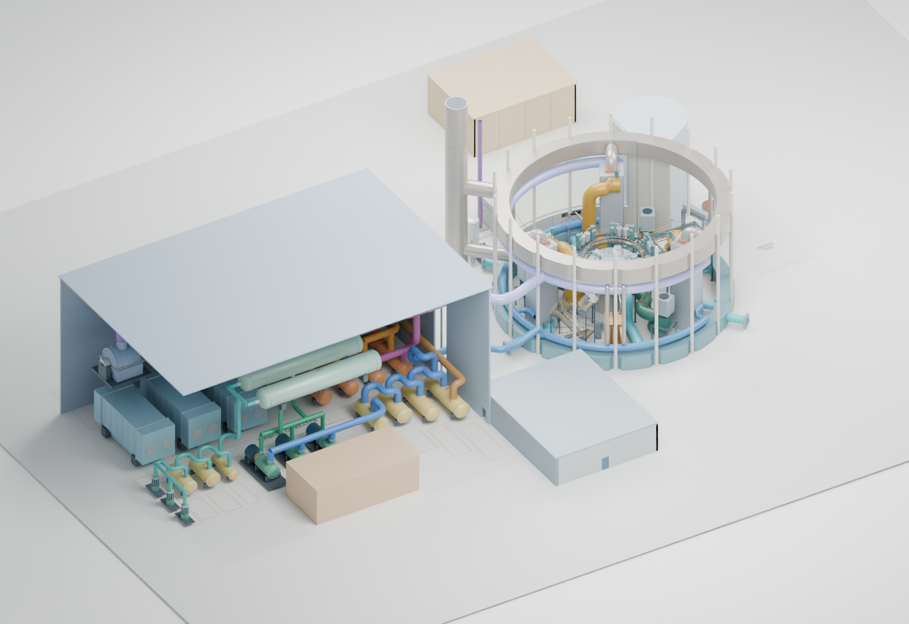
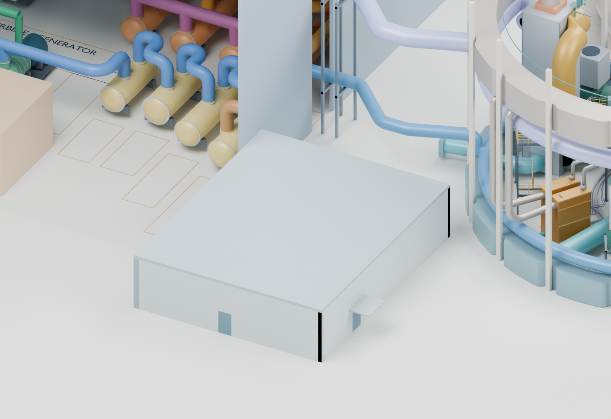
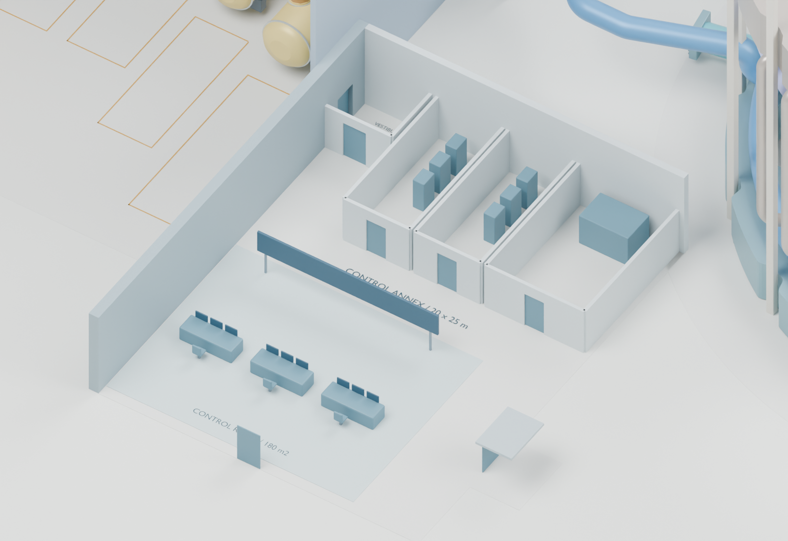
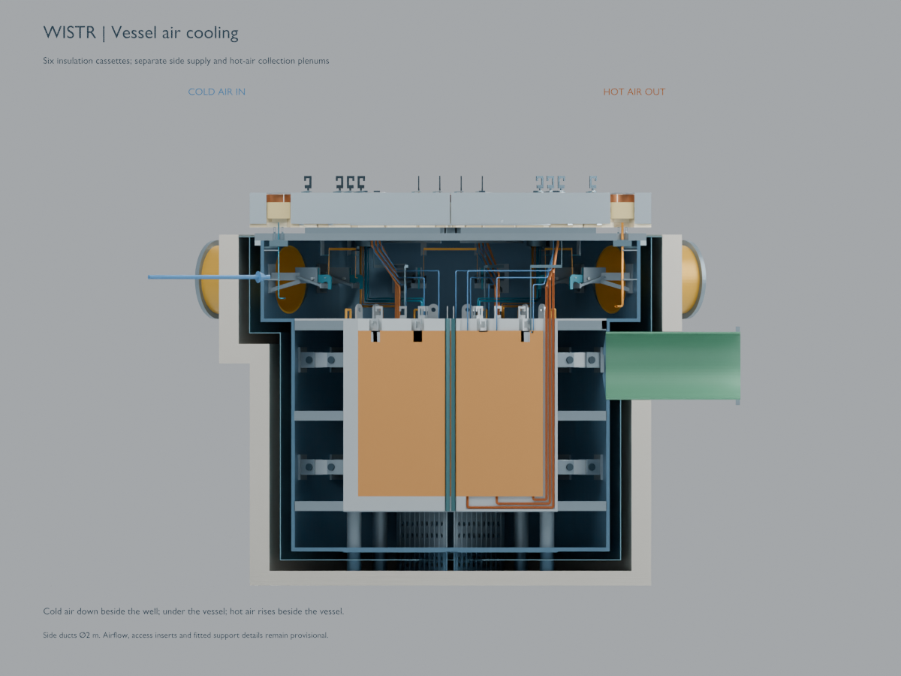
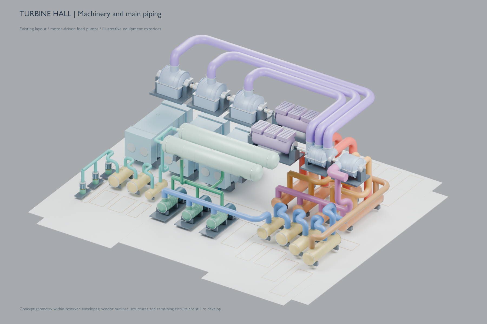
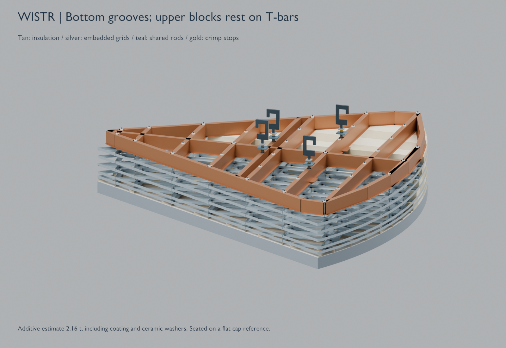

# Model gallery

[Project hub](https://github.com/FastSaltSystem/fastSalt) · [Model sources and Blender downloads](../README.md)

Selected views can be opened directly on GitHub. Click an image to inspect it at full resolution. Each caption identifies the depicted revision: these are preliminary visual studies, not a single synchronized plant release.

## Overall plant — 14 October 2026 draft

The control-annex composition includes the reactor building, steam power plant and service-building reservations. Roofs and walls are hidden selectively. This is the most recent complete-site view in this gallery. [Design and checks](../docs/control-annex.md) · [Snapshot provenance](2026-10-15/README.md).

## Control annex — 14 October 2026 draft

The rooms and console envelopes illustrate a provisional arrangement. They are not a staffing, shielding or habitability specification.

## Reactor vessel and well — 11 October 2026 checkpoint

The section illustrates the insulated reactor top and side air connections. It predates the later absorber review and fuel-maintenance P&ID refinements. [Open the preserved Blender scene](../baselines/wistr-insulated-installation-2026-10-11/reactor/wistr-reactor-study.blend) · [Checkpoint record](../baselines/wistr-insulated-installation-2026-10-11/README.md).

## Turbine equipment — 12 October 2026 checkpoint

Illustrative turbines, generators, reheaters, condensers and motor-driven feed pumps. These are equipment reservations, not vendor designs. [Download the complete site model](../baselines/turbine-equipment-2026-10-12/fast-salt-site.blend) · [Checkpoint and additional views](../baselines/turbine-equipment-2026-10-12/README.md).

## Removable insulation cassette — 11 October 2026 checkpoint

The section shows the block layers and suspended T-grids. [Design notes](../docs/tgrid-insulation-cover.md) · [Preserved checkpoint](../baselines/wistr-insulated-installation-2026-10-11/README.md).

## Updating the gallery

Keep ordinary renders in ignored `outputs/`. Publish selected images in a new dated `results/` directory, recording their original paths, sizes, SHA-256 hashes and source commit. Inspect the images and update their captions before opening a pull request. Preserve earlier snapshots; a gallery update does not silently revise their design status.
